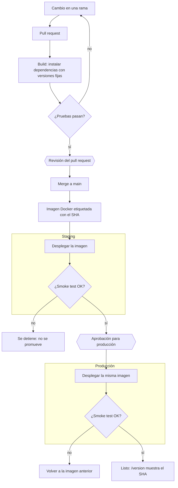

# Mapa de estrategia CI/CD - API de tareas

> Autor o autora:  Melissa Umanzor Jimenez
> Punto de partida: `docs/DESPLIEGUE_MANUAL.md`, el proceso manual que el pipeline va a reemplazar.
> Cómo se ve un mapa terminado: `docs/ejemplo-mapa-cicd-sitio.md` (otro caso, mismo método).
> Sintaxis de los diagramas: la Guía rápida de Mermaid (Moodle, material de apoyo).


## 0. El proceso manual de partida
El equipo de plataforma **Comercial Delta** (empresa ficticia) publica su sitio así:
 
  1. Pedir por chat a alguien de desarrollo que confirme que "las pruebas pasaron".
  2.  Avisar en el canal general que la API va a estar caída unos minutos.
  3. Tener a mano la clave del servidor (está en el correo de bienvenida de quien despliega).

Pasos:
1. Entrar al servidor por SSH como `root`.
2. Ir a la carpeta de la aplicación y traer lo último. Si `git pull` da conflicto, borrar la carpeta y volver a clonar.
   ```bash
   cd /opt/api-tareas
   git pull
3. Instalar las dependencias:  
   ```bash
   pip install flask gunicorn
   ```
4. Configurar el token de la API:  
   ```bash
   export API_TOKEN=tok_prod_7f3a9c21
   ```
5. Busca el proceso de gunicorn y lo termina con `kill -9`.  
   ```bash
   `ps aux | grep gunicorn`
   `kill -9`
   ```

6. Arrancar la versión nueva:  
   ```bash
   nohup gunicorn -b 0.0.0.0:8000 "app:create_app()" &
   ```
7. Abrir `http://<servidor>:8000/tareas` en el navegador. Si carga, el despliegue salió bien.
8. Avisar en el canal general que la API volvió.

**Si algo sale mal**: Hacer un roll back con `git checkout` al commit de la semana pasada (preguntar cuál era) yrepetir los pasos 3 a 7.
 
**Historial Reciente**:  
Hace 3 semanas | La API no arrancó: `pip` instaló una versión nueva de Flask que cambió un comportamiento. Se resolvió a las dos horas fijando la versión a mano en el servidor.
Hace 2 semanas | El despliegue "salió bien" (la página `/tareas` cargaba) pero `POST /tareas` respondía 401 a todos: el token quedó vacío porque la sesión SSH se cerró antes del paso 6.
a semana pasada | Nadie sabía qué commit estaba corriendo en el servidor. Se revisó a mano comparando archivos.

## 1. Flujo de commit a producción

Reemplazar este esqueleto por el flujo completo: etapas, ambientes y los puntos donde decide una
persona. GitHub y la vista previa de VS Code (`Ctrl+Shift+V`) muestran el diagrama. Si queda muy
ancho, cambiar `LR` por `TD`.  
  




## 2. Ambientes

| Ambiente | Para qué sirve | Cómo llega un cambio | Quién decide que llegue |
|---|---|---|---|
| Local | Desarrollar y correr las pruebas y el smoke test en la computadora | Quien desarrolla trabaja en su rama | Quien desarrolla |
| Staging | Probar la imagen que construyó el pipeline, igual a producción pero sin usuarios | Automático, después del merge a `main` | Nadie: el pipeline |
| Producción | La API que usan los usuarios | La misma imagen que pasó por staging | Una persona que aprueba en el pipeline |


## 3. Riesgos del proceso manual y controles

Un renglón por riesgo. La columna "Paso" cita el paso de `DESPLIEGUE_MANUAL.md`.

| Paso | Riesgo | Qué puede pasar | Control del pipeline que lo atiende | Etapa del flujo |
|---|---|---|---|---|
| Antes de empezar | Algun desarrollador confirma que las pruebas pasaron manualmente o por memoria | Se corre el riesgo de desplegar código con pruebas fallando | El pipeline corre las pruebas en cada pull request y bloquea el merge si fallan | Pruebas |
| Antes de empezar | La clave y el token están en un correo y escritos en este documento | Cualquiera que lea el correo o el documento puede entrar o usar la API | Token y credenciales guardados como secretos del ambiente; solo el pipeline los usa. El token expuesto se cambia | Despliegue |
| 1 | Se entra al servidor como `root` | Un error o una persona con malas intenciones puede dañar todo el servidor | El pipeline despliega con una cuenta de permisos mínimos; nadie entra a mano | Despliegue |
| 2 | `git pull` en el servidor, o borrar y volver a clonar | Se despliega un estado a medias o un código distinto al revisado | La imagen se construye una sola vez desde `main`; el servidor no compila nada | Artefacto |
| 3 | `pip install` sin versiones (historial) | Una versión nueva de Flask rompe la API | Dependencias fijadas en `requirements.txt` e instaladas en el build, donde las pruebas lo detectan | Build |
| 4 a 6 | El token se configura con `export` y se pierde si se cierra la sesión (historial) | La API parece funcionar, pero rechaza todas las tareas nuevas por falta de token| El token se inyecta como secreto en la configuración del servicio; el smoke test prueba un `POST` autenticado | Despliegue y validación posterior |
| 5 | `kill -9` a la versión anterior | La API se cae durante el despliegue | La versión nueva arranca y pasa `/health` antes de reemplazar a la anterior | Despliegue |
| 7 | "Si carga en el navegador, salió bien" | La página carga, pero otras partes de la API pueden estar fallando sin que nadie lo note| Smoke test automático contra `/health`, `/version` y `/tareas` | Validación posterior |
| Si algo sale mal | Hay que preguntar a qué commit volver (historial) | No se sabe qué corría ni cómo volver | Cada versión queda guardada con su etiqueta (SHA) por si hay que volver a desplegar la anterior| Artefacto |

## 4. Criterios de éxito

Qué tiene que ser verdad para decir que un despliegue salió bien, de forma que una máquina lo
pueda comprobar.

- `bash scripts/pruebas.sh` termina sin fallos (0 failed).
- `GET /health` responde 200 con `"estado": "ok"`, en staging y en producción.
- `GET /version` responde con la versión igual al SHA del commit desplegado y el ambiente correcto.
- `GET /tareas` responde 200.
- `POST /tareas` con el token responde 201 y sin token responde 401.
- `bash scripts/smoke.sh <url>` termina con "Smoke test superado" (código de salida 0).

Ninguno dice "carga en el navegador": cada uno se comprueba con un comando o una respuesta de la API.

## 5. Decisiones y preguntas abiertas

-
